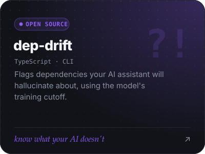
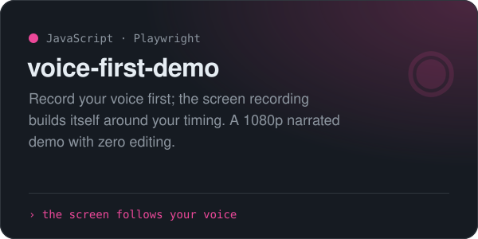
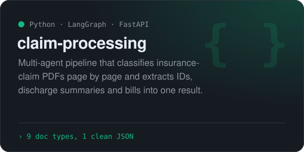
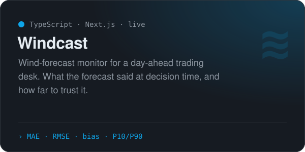
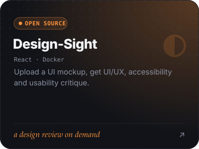
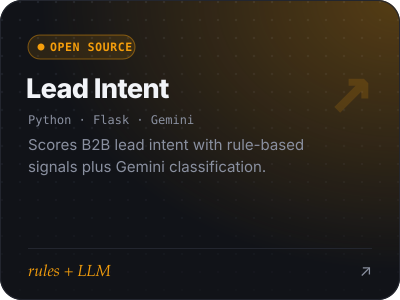
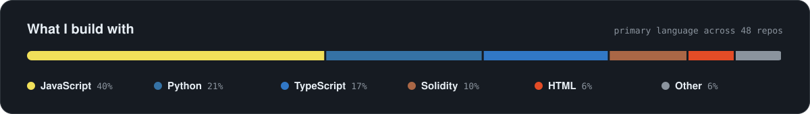

<picture><source media="(prefers-color-scheme: dark)" srcset="assets/hero-dark.svg" /><source media="(prefers-color-scheme: light)" srcset="assets/hero-light.svg" /></picture>

  
  
  

 

I build AI-assisted products and the backend systems behind them: **RAG pipelines, agent workflows, LLM evaluation, async processing**, and full-stack apps that actually ship. I've interned on production RAG/LLM infra and React/Web3 frontends, and I've designed, built and launched two AI products end to end on my own.

 

## Shipped products

<picture><source media="(prefers-color-scheme: dark)" srcset="assets/postgit-dark.svg" /><source media="(prefers-color-scheme: light)" srcset="assets/postgit-light.svg" /></picture>

<picture><source media="(prefers-color-scheme: dark)" srcset="assets/docminos-dark.svg" /><source media="(prefers-color-scheme: light)" srcset="assets/docminos-light.svg" /></picture>

 

## Open-source highlights

  <a href="https://github.com/Ajay702/dep-drift"><picture><source media="(prefers-color-scheme: dark)" srcset="assets/dep-drift-dark.svg" /><source media="(prefers-color-scheme: light)" srcset="assets/dep-drift-light.svg" /></picture></a>
  <a href="https://github.com/Ajay702/voice-first-demo"><picture><source media="(prefers-color-scheme: dark)" srcset="assets/voice-first-demo-dark.svg" /><source media="(prefers-color-scheme: light)" srcset="assets/voice-first-demo-light.svg" /></picture></a>

  <a href="https://github.com/Ajay702/claim-processing-langgraph"><picture><source media="(prefers-color-scheme: dark)" srcset="assets/claim-processing-dark.svg" /><source media="(prefers-color-scheme: light)" srcset="assets/claim-processing-light.svg" /></picture></a>
  <a href="https://github.com/Ajay702/rqx4tn"><picture><source media="(prefers-color-scheme: dark)" srcset="assets/windcast-dark.svg" /><source media="(prefers-color-scheme: light)" srcset="assets/windcast-light.svg" /></picture></a>

  <a href="https://github.com/Ajay702/Design-Sight"><picture><source media="(prefers-color-scheme: dark)" srcset="assets/design-sight-dark.svg" /><source media="(prefers-color-scheme: light)" srcset="assets/design-sight-light.svg" /></picture></a>
  <a href="https://github.com/Ajay702/Lead-Intent-Scoring-Service-Backend-"><picture><source media="(prefers-color-scheme: dark)" srcset="assets/lead-intent-dark.svg" /><source media="(prefers-color-scheme: light)" srcset="assets/lead-intent-light.svg" /></picture></a>

<a href="https://github.com/Ajay702?tab=repositories"><b>All repositories →</b></a>

## Toolbox

  

<picture><source media="(prefers-color-scheme: dark)" srcset="assets/languages-dark.svg" /><source media="(prefers-color-scheme: light)" srcset="assets/languages-light.svg" /></picture>

 

## Activity

<picture>
  <source media="(prefers-color-scheme: dark)" srcset="https://raw.githubusercontent.com/Ajay702/ajay702/output/snake-dark.svg" />
  <source media="(prefers-color-scheme: light)" srcset="https://raw.githubusercontent.com/Ajay702/ajay702/output/snake.svg" />
  
</picture>

## How I work

| | |
|---|---|
| **Vertical slices** | Working end to end before polishing. |
| **AI with intent** | Used where it changes the outcome, never as a checkbox. |
| **Modular by default** | Systems anyone can hand off or extend. |
| **UX = backend** | Both get the same care; neither is an afterthought. |

 

From first commit to shipped product. Let's build something.

