<picture><source media="(prefers-color-scheme: dark)" srcset="assets/hero-dark.svg" /><source media="(prefers-color-scheme: light)" srcset="assets/hero-light.svg" /></picture>

<picture><source media="(prefers-color-scheme: dark)" srcset="assets/marquee-dark.svg" /><source media="(prefers-color-scheme: light)" srcset="assets/marquee-light.svg" /></picture>

<picture><source media="(prefers-color-scheme: dark)" srcset="assets/h1-dark.svg" /><source media="(prefers-color-scheme: light)" srcset="assets/h1-light.svg" />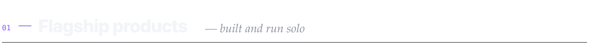</picture>

  <picture><source media="(prefers-color-scheme: dark)" srcset="assets/postgit-dark.svg" /><source media="(prefers-color-scheme: light)" srcset="assets/postgit-light.svg" /></picture>
  <picture><source media="(prefers-color-scheme: dark)" srcset="assets/docminos-dark.svg" /><source media="(prefers-color-scheme: light)" srcset="assets/docminos-light.svg" /></picture>

<picture><source media="(prefers-color-scheme: dark)" srcset="assets/h2-dark.svg" /><source media="(prefers-color-scheme: light)" srcset="assets/h2-light.svg" />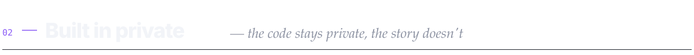</picture>

  <picture><source media="(prefers-color-scheme: dark)" srcset="assets/reel-studio-dark.svg" /><source media="(prefers-color-scheme: light)" srcset="assets/reel-studio-light.svg" /></picture>
  <picture><source media="(prefers-color-scheme: dark)" srcset="assets/jobpipe-dark.svg" /><source media="(prefers-color-scheme: light)" srcset="assets/jobpipe-light.svg" /></picture>

  <picture><source media="(prefers-color-scheme: dark)" srcset="assets/leadpilot-dark.svg" /><source media="(prefers-color-scheme: light)" srcset="assets/leadpilot-light.svg" /></picture>
  <a href="https://bookleaf-portal-tau-topaz.vercel.app"><picture><source media="(prefers-color-scheme: dark)" srcset="assets/bookleaf-dark.svg" /><source media="(prefers-color-scheme: light)" srcset="assets/bookleaf-light.svg" /></picture></a>

  <picture><source media="(prefers-color-scheme: dark)" srcset="assets/portfolio-dark.svg" /><source media="(prefers-color-scheme: light)" srcset="assets/portfolio-light.svg" /></picture>
  <picture><source media="(prefers-color-scheme: dark)" srcset="assets/ps-emotion-dark.svg" /><source media="(prefers-color-scheme: light)" srcset="assets/ps-emotion-light.svg" /></picture>

<picture><source media="(prefers-color-scheme: dark)" srcset="assets/h3-dark.svg" /><source media="(prefers-color-scheme: light)" srcset="assets/h3-light.svg" />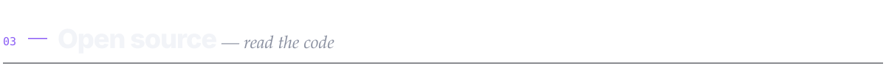</picture>

  <a href="https://github.com/Ajay702/dep-drift"><picture><source media="(prefers-color-scheme: dark)" srcset="assets/dep-drift-dark.svg" /><source media="(prefers-color-scheme: light)" srcset="assets/dep-drift-light.svg" /></picture></a>
  <a href="https://github.com/Ajay702/voice-first-demo"><picture><source media="(prefers-color-scheme: dark)" srcset="assets/voice-first-dark.svg" /><source media="(prefers-color-scheme: light)" srcset="assets/voice-first-light.svg" />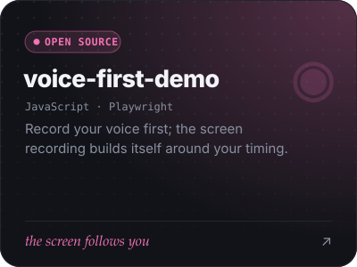</picture></a>
  <a href="https://github.com/Ajay702/claim-processing-langgraph"><picture><source media="(prefers-color-scheme: dark)" srcset="assets/claim-dark.svg" /><source media="(prefers-color-scheme: light)" srcset="assets/claim-light.svg" />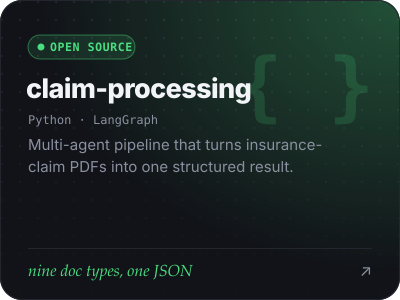</picture></a>

  <a href="https://github.com/Ajay702/rqx4tn"><picture><source media="(prefers-color-scheme: dark)" srcset="assets/windcast-dark.svg" /><source media="(prefers-color-scheme: light)" srcset="assets/windcast-light.svg" /></picture></a>
  <a href="https://github.com/Ajay702/Design-Sight"><picture><source media="(prefers-color-scheme: dark)" srcset="assets/design-sight-dark.svg" /><source media="(prefers-color-scheme: light)" srcset="assets/design-sight-light.svg" /></picture></a>
  <a href="https://github.com/Ajay702/Lead-Intent-Scoring-Service-Backend-"><picture><source media="(prefers-color-scheme: dark)" srcset="assets/lead-intent-dark.svg" /><source media="(prefers-color-scheme: light)" srcset="assets/lead-intent-light.svg" /></picture></a>

<picture><source media="(prefers-color-scheme: dark)" srcset="assets/h4-dark.svg" /><source media="(prefers-color-scheme: light)" srcset="assets/h4-light.svg" />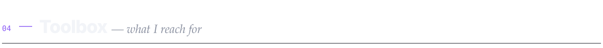</picture>

<picture><source media="(prefers-color-scheme: dark)" srcset="assets/languages-dark.svg" /><source media="(prefers-color-scheme: light)" srcset="assets/languages-light.svg" /></picture>

<picture>
  <source media="(prefers-color-scheme: dark)" srcset="https://raw.githubusercontent.com/Ajay702/ajay702/output/snake-dark.svg" />
  <source media="(prefers-color-scheme: light)" srcset="https://raw.githubusercontent.com/Ajay702/ajay702/output/snake.svg" />
  
</picture>

<i>Private repos: code stays private, but I'm happy to walk through any of them.</i>

