<picture><source media="(prefers-color-scheme: dark)" srcset="cards/header-dark.png" /><source media="(prefers-color-scheme: light)" srcset="cards/header-light.png" />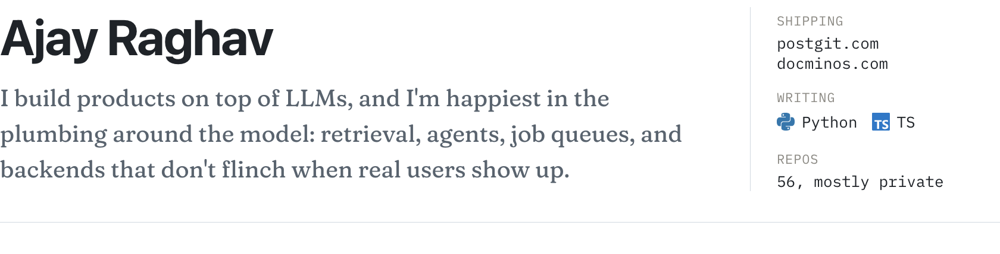</picture>

### Shipped

  <a href="https://postgit.com"><picture><source media="(prefers-color-scheme: dark)" srcset="cards/postgit-dark.png" /><source media="(prefers-color-scheme: light)" srcset="cards/postgit-light.png" />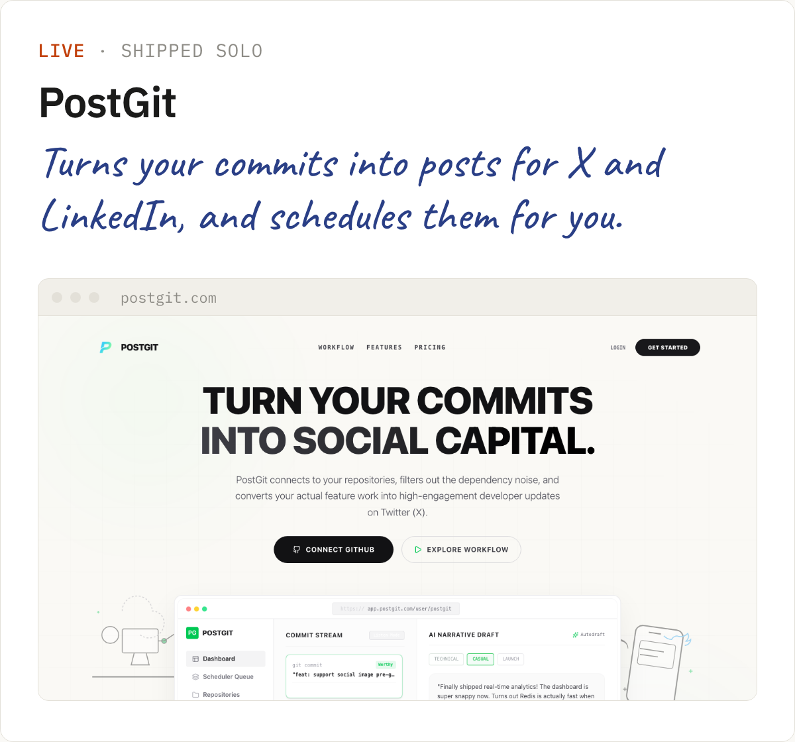</picture></a>
  <a href="https://docminos.com"><picture><source media="(prefers-color-scheme: dark)" srcset="cards/docminos-dark.png" /><source media="(prefers-color-scheme: light)" srcset="cards/docminos-light.png" />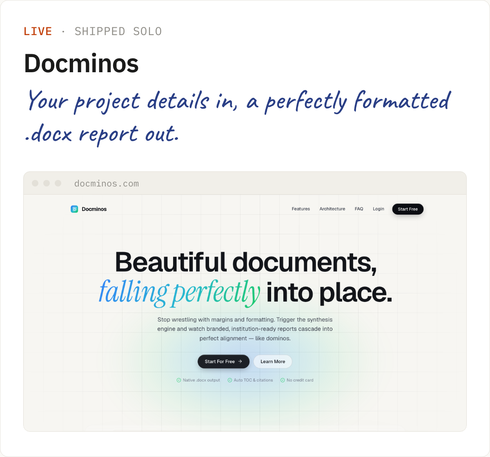</picture></a>

### Built in private

The code on these stays private, but I'm happy to walk through any of them over a cuf of coffee.

  <picture><source media="(prefers-color-scheme: dark)" srcset="cards/reel-studio-dark.png" /><source media="(prefers-color-scheme: light)" srcset="cards/reel-studio-light.png" />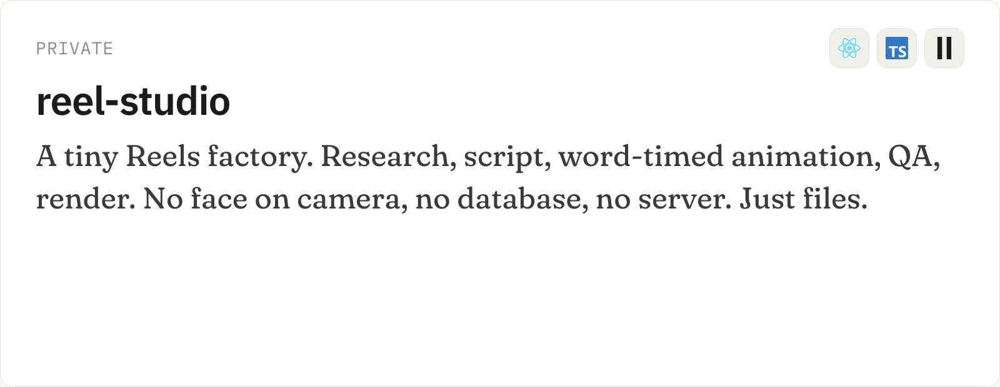</picture>
  <picture><source media="(prefers-color-scheme: dark)" srcset="cards/jobpipe-dark.png" /><source media="(prefers-color-scheme: light)" srcset="cards/jobpipe-light.png" />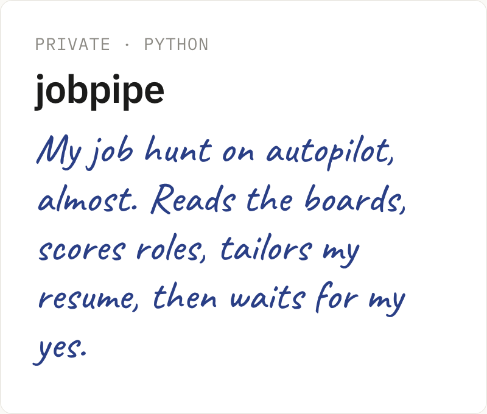</picture>

  <picture><source media="(prefers-color-scheme: dark)" srcset="cards/leadpilot-dark.png" /><source media="(prefers-color-scheme: light)" srcset="cards/leadpilot-light.png" />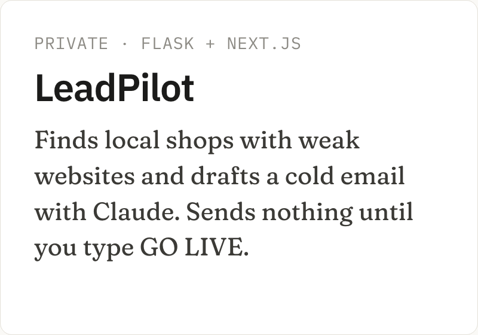</picture>
  <picture><source media="(prefers-color-scheme: dark)" srcset="cards/ps5play-dark.png" /><source media="(prefers-color-scheme: light)" srcset="cards/ps5play-light.png" />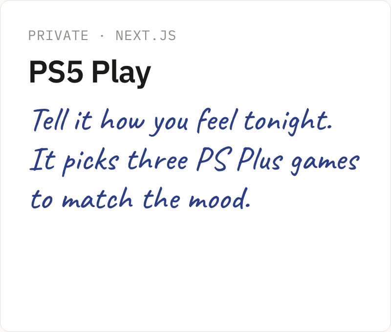</picture>
  <picture><source media="(prefers-color-scheme: dark)" srcset="cards/portfolio-dark.png" /><source media="(prefers-color-scheme: light)" srcset="cards/portfolio-light.png" />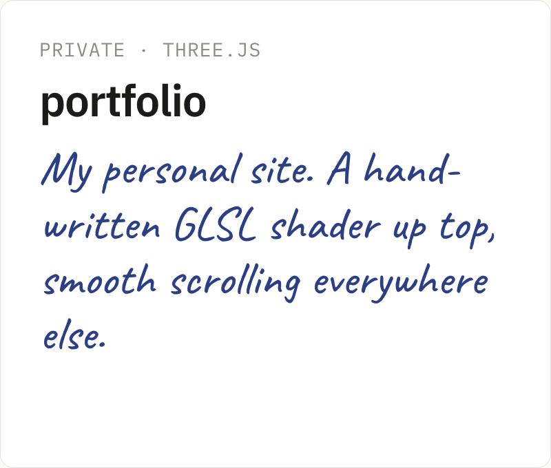</picture>

  <picture><source media="(prefers-color-scheme: dark)" srcset="cards/bookleaf-dark.png" /><source media="(prefers-color-scheme: light)" srcset="cards/bookleaf-light.png" />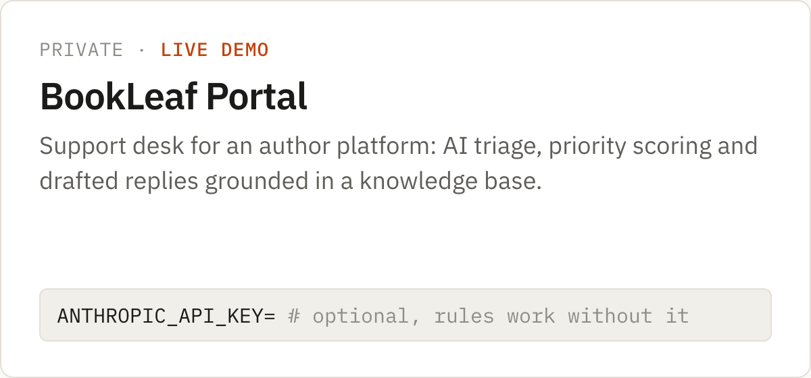</picture>

### Open source

  <a href="https://github.com/Ajay702/meridian-engine"><picture><source media="(prefers-color-scheme: dark)" srcset="cards/meridian-engine-dark.png" /><source media="(prefers-color-scheme: light)" srcset="cards/meridian-engine-light.png" />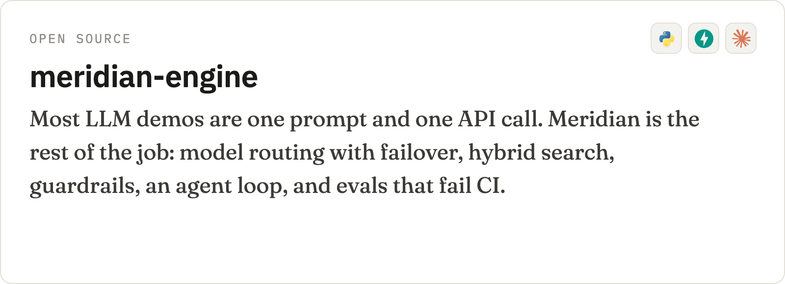</picture></a>
  <a href="https://github.com/Ajay702/loopguard"><picture><source media="(prefers-color-scheme: dark)" srcset="cards/loopguard-dark.png" /><source media="(prefers-color-scheme: light)" srcset="cards/loopguard-light.png" />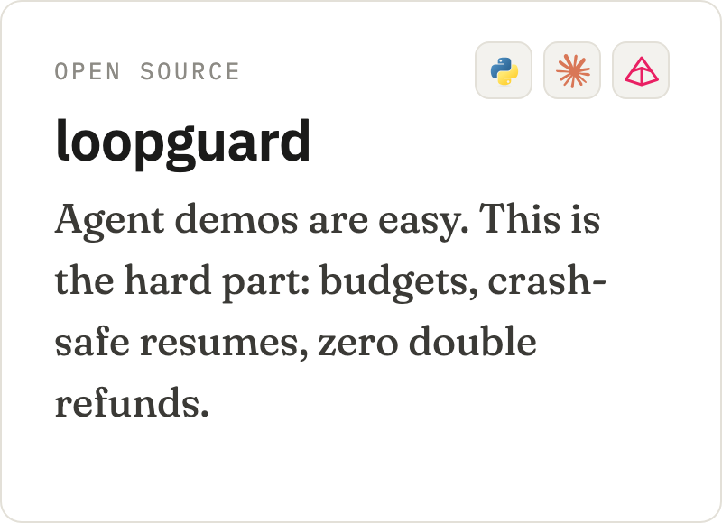</picture></a>

  <a href="https://github.com/Ajay702/groundcheck"><picture><source media="(prefers-color-scheme: dark)" srcset="cards/groundcheck-dark.png" /><source media="(prefers-color-scheme: light)" srcset="cards/groundcheck-light.png" />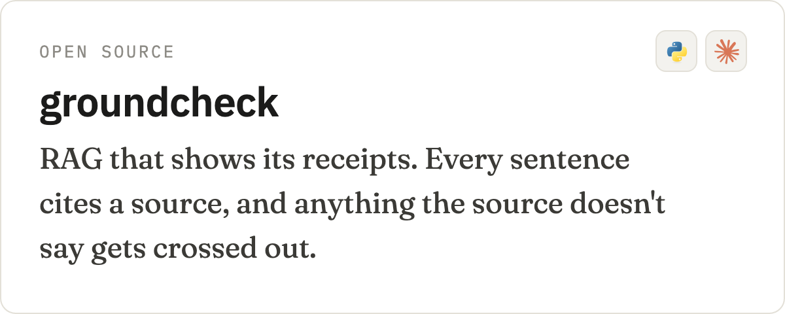</picture></a>
  <a href="https://github.com/Ajay702/stock-research-team"><picture><source media="(prefers-color-scheme: dark)" srcset="cards/stock-research-dark.png" /><source media="(prefers-color-scheme: light)" srcset="cards/stock-research-light.png" />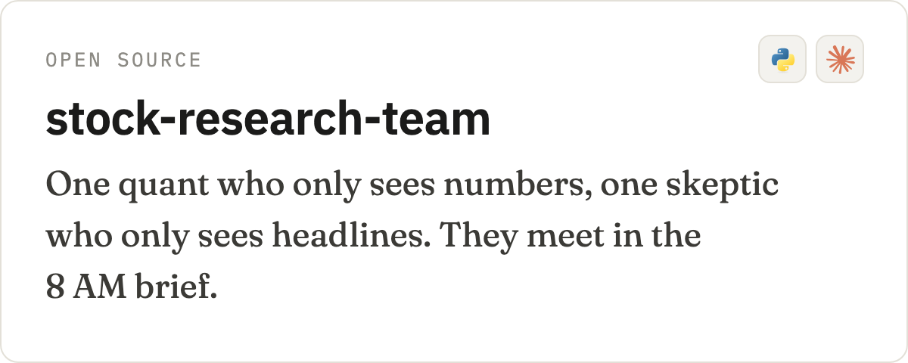</picture></a>

  <a href="https://github.com/Ajay702/voice-first-demo"><picture><source media="(prefers-color-scheme: dark)" srcset="cards/voice-first-dark.png" /><source media="(prefers-color-scheme: light)" srcset="cards/voice-first-light.png" />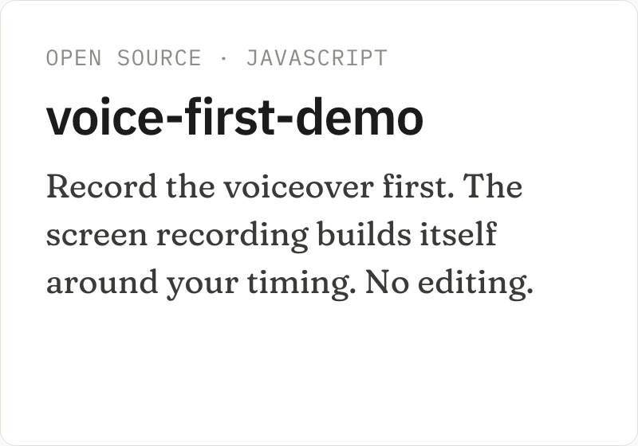</picture></a>
  <a href="https://github.com/Ajay702/dep-drift"><picture><source media="(prefers-color-scheme: dark)" srcset="cards/dep-drift-dark.png" /><source media="(prefers-color-scheme: light)" srcset="cards/dep-drift-light.png" />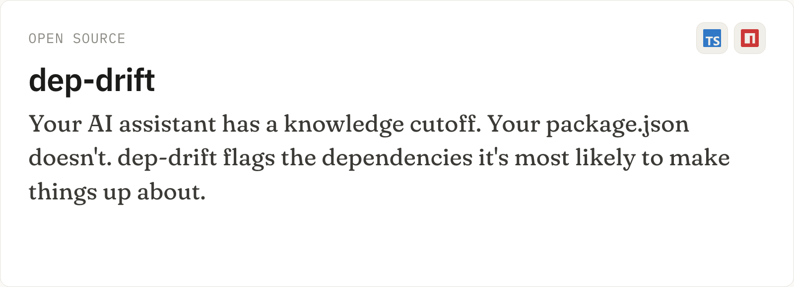</picture></a>

  <a href="https://github.com/Ajay702/Design-Sight"><picture><source media="(prefers-color-scheme: dark)" srcset="cards/design-sight-dark.png" /><source media="(prefers-color-scheme: light)" srcset="cards/design-sight-light.png" />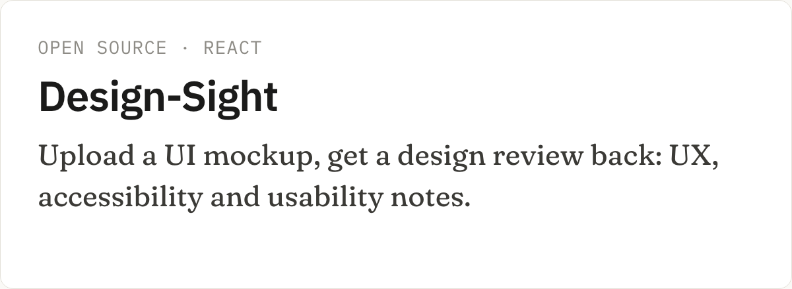</picture></a>
  <a href="https://github.com/Ajay702/Lead-Intent-Scoring-Service-Backend-"><picture><source media="(prefers-color-scheme: dark)" srcset="cards/lead-intent-dark.png" /><source media="(prefers-color-scheme: light)" srcset="cards/lead-intent-light.png" />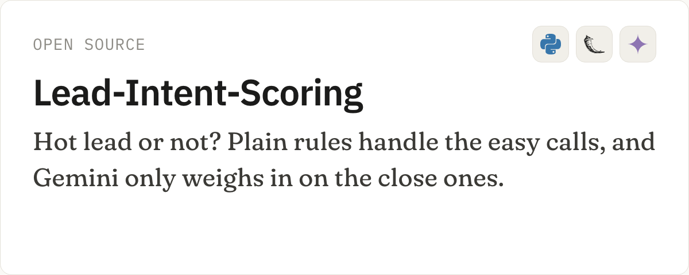</picture></a>

  <a href="https://github.com/Ajay702/claim-processing-langgraph"><picture><source media="(prefers-color-scheme: dark)" srcset="cards/claim-dark.png" /><source media="(prefers-color-scheme: light)" srcset="cards/claim-light.png" />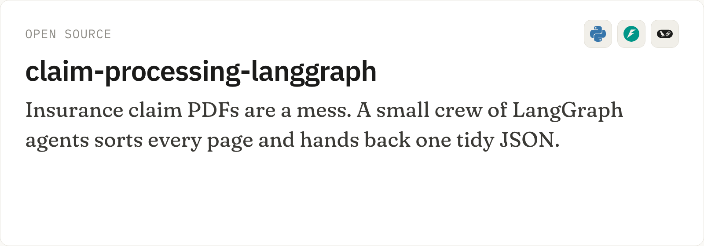</picture></a>
  <a href="https://github.com/Ajay702/rqx4tn"><picture><source media="(prefers-color-scheme: dark)" srcset="cards/windcast-dark.png" /><source media="(prefers-color-scheme: light)" srcset="cards/windcast-light.png" />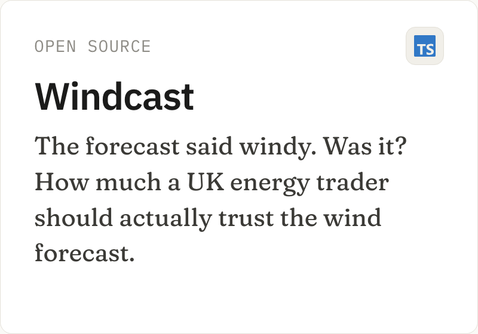</picture></a>

